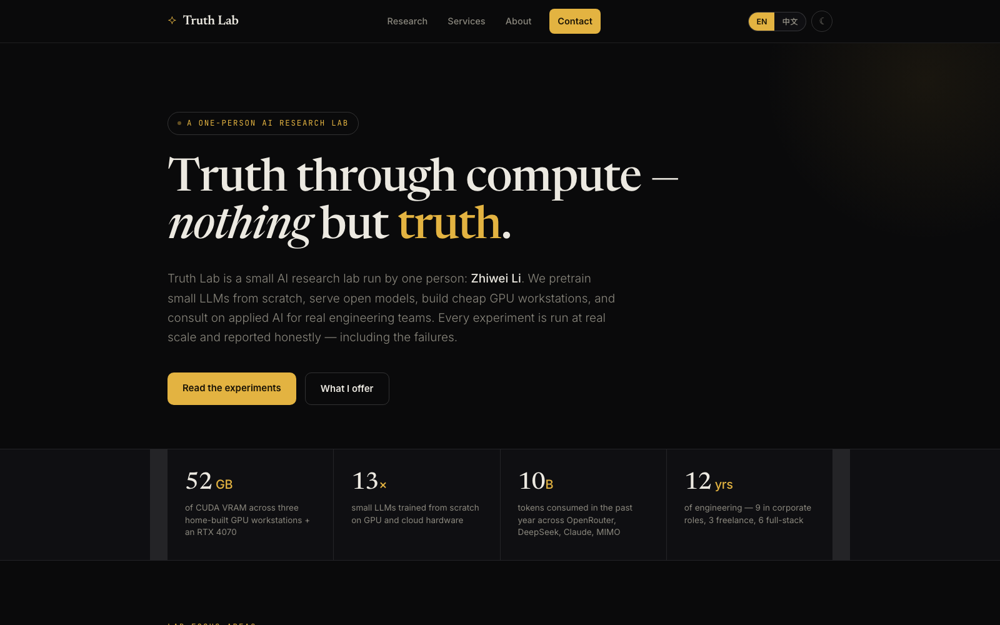
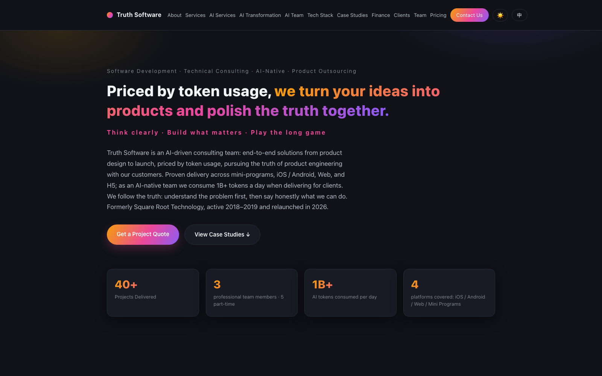
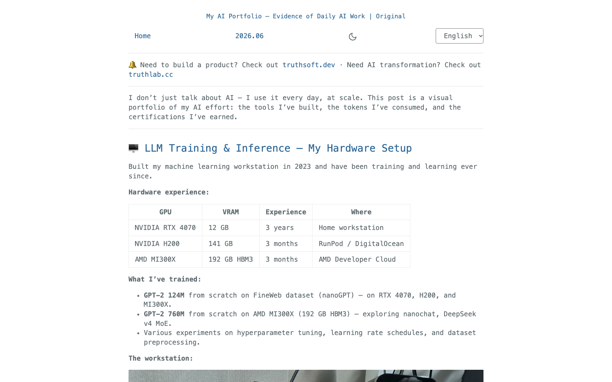
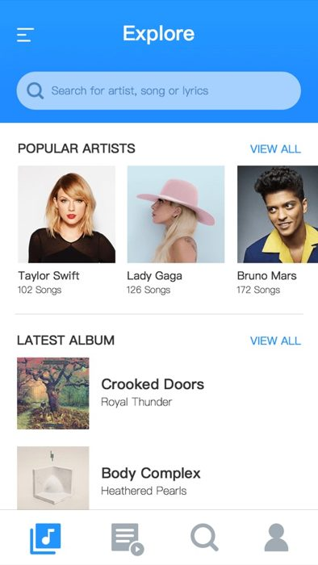
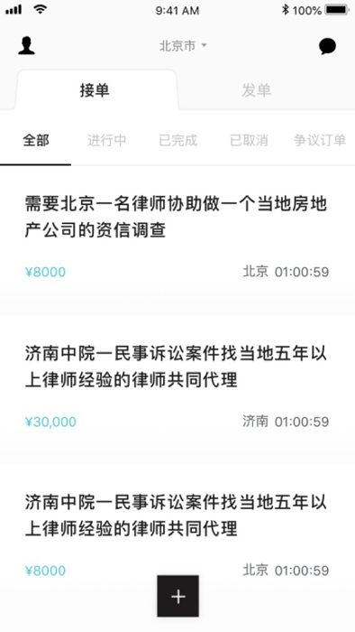
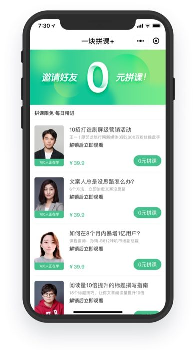
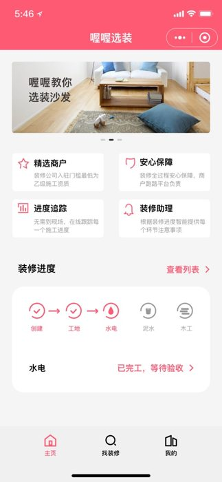

<!-- _class: cover -->
# Three Projects, One Builder
三个项目 · 一位建造者

Zhiwei Li · @lzwjava 
AI research &nbsp;·&nbsp; Software studio &nbsp;·&nbsp; AI-powered blog

<!-- notes: Greeting — hi I'm Zhiwei Li, I build software, train AI models, and write about both. Today I'm announcing three projects that all build on each other: an AI research lab, a software studio, and an AI-powered blog. -->

---

<!-- _class: project -->

AGENDA

今天的内容 · WHAT'S INSIDE

# 01 · 02 · 03
三个项目 · 一条线

- **Truth Lab** 求真实验室 — 从零训练小模型，二手显卡，诚实的实验
- **Truth Software** 求真软件 — 40+ 交付产品，AI 原生团队
- **lzwjava.com** AI 博客 · 作品集 — 翻译 · 朗读 · PDF/EPUB，真实数据

<!-- notes: Three projects, one builder. The lab does the research, the studio ships the products, and the blog documents everything with evidence. -->

---

<!-- _class: project -->

01 / 03

PROJECT 01 · AI RESEARCH LAB

# Truth Lab
求真实验室

- Small LLMs trained from scratch 从零训练小型大语言模型
- 52 GB home GPU cluster from used parts 52GB 家用显卡集群 · 二手件
- Every experiment reported honestly — failures included 所有实验如实公开，包括失败

<!-- notes: Truth Lab is a one-person AI research lab. I pretrain GPT-2-scale models from zero on real data, I resurrect second-hand datacenter GPUs — 52 GB of VRAM at home — and I publish every result honestly, including the failures. Truth through compute. -->

---

TRUTHLAB.CC · LIVE SITE

## One lab, run in the open
Training runs · hardware bills · honest charts

<!-- notes: This is what the lab looks like online — a single-file static site, dark and typographic, with the full experiment notebook: 13+ training runs, statuses, hardware, and honest numbers. -->

---

<!-- _class: project -->

02 / 03

PROJECT 02 · CONSULTING STUDIO

# Truth Software
求真软件

- 40+ products delivered & shipped 交付 40+ 个产品
- AI-native team · 1B+ tokens a day AI 原生团队 · 每日 10亿+ tokens
- AI roadmap delivered in weeks, not months 数周交付 AI 转型方案

<!-- notes: Truth Software is the consulting studio — 40+ delivered products from WeChat Mini Programs to iOS, Android and web. Today delivery runs on an AI-native pipeline: more than a billion tokens a day, dozens of custom agents, hundreds of automation scripts. -->

---

TRUTHSOFT.DEV · LIVE SITE

## Software, done honestly
AI transformation · teams · portfolio of delivered work

<!-- notes: truthsoft.dev presents the studio — services, AI transformation consulting, real case studies with screenshots, and a manifesto of six principles. -->

---

<!-- _class: project -->

03 / 03

PROJECT 03 · AI-POWERED BLOG

# lzwjava.com
AI 博客 · 作品集

- Every post AI-translated, narrated, PDF & EPUB 每篇：AI 翻译 · 朗读 · PDF 与 EPUB
- AI portfolio: benchmarks, hardware, training logs AI 作品集：基准、硬件、训练日志
- Software portfolio: a decade of shipped work 软件作品集：十年的交付

<!-- notes: lzwjava.com is the home base — every article is machine-translated, narrated, exported to PDF and EPUB automatically. It hosts both my AI portfolio and my software portfolio, backed by benchmarks, training logs and certifications. -->

---

LZWJAVA.COM · LIVE SITE

## Evidence of daily work
AI portfolio · software portfolio · 10 万月活 · 100k monthly visits

<!-- notes: The AI portfolio post shows real evidence of daily AI work — hardware, teardowns, benchmarks, certifications. The software portfolio collects a decade of shipped products across companies and partners. -->

---

<!-- _class: gallery_slide -->

PORTFOLIO

SOME SHIPPED WORK · 部分交付

# Real products, real users
真实的产品 · 真实的用户

<!-- notes: A small slice of the product gallery — community, legal, career and home-renovation apps, mostly WeChat Mini Programs, from the 40+ delivered projects in the case book. -->

---

<!-- _class: cta -->

LET'S BUILD

# Build something honest.
一起来，求真的创造

- AI transformation? AI 转型？ → truthlab.cc
- Software done right? 产品放心做？ → truthsoft.dev
- Follow the journey 关注进展 → lzwjava.com

<!-- notes: Everything connects. AI transformation → Truth Lab. Software done right → Truth Software. Follow along → lzwjava.com. Collaboration is token-based: tell me what to help with, pay for what's used. Let's build something honest. -->
